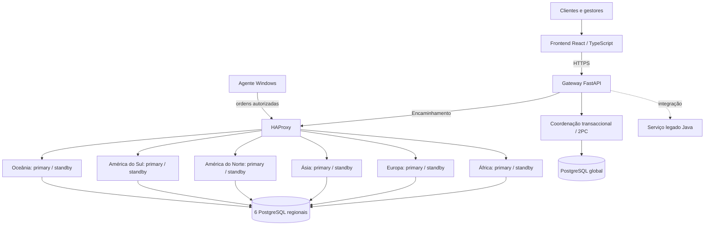
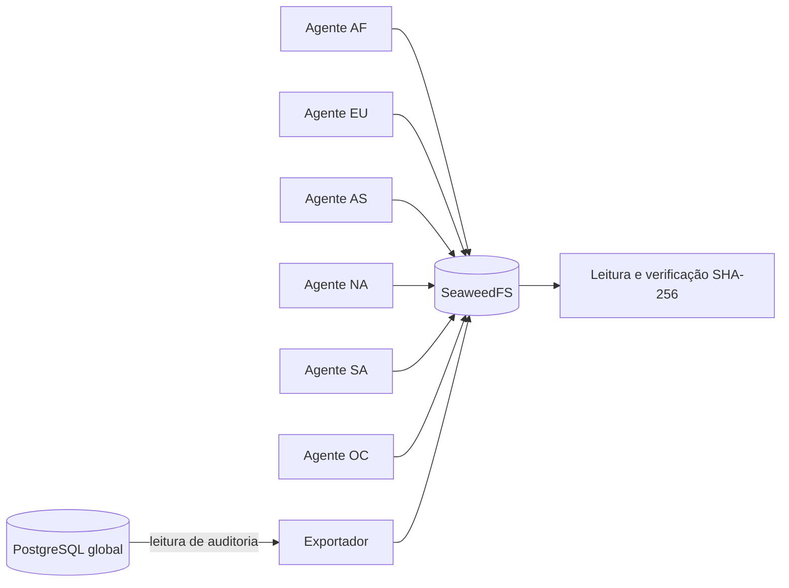

<div align="center">


# NandBank

### Banco digital distribuído · Seis continentes. Uma rede.

**Uma plataforma bancária académica que demonstra transacções entre regiões, alta disponibilidade de aplicação, controlo de nós e armazenamento distribuído de ficheiros.**

[](https://fastapi.tiangolo.com/)
[](https://react.dev/)
[](https://www.postgresql.org/)
[](https://www.docker.com/)
[](https://github.com/seaweedfs/seaweedfs)

**Projecto académico · Sistemas Distribuídos e Paralelos · ISUTC · 2026**

[Visão geral](#-visão-geral) · [Funcionalidades](#-funcionalidades) · [Arquitectura](#-arquitectura-do-sistema) · [Instalação](#-executar-localmente) · [Testes](#-testes-e-evidências) · [Documentação](#-documentação)

</div>

---

> [!IMPORTANT]
> O **NandBank é um protótipo académico**. Todas as contas, moedas, saldos, cartões e operações são fictícios. **Não movimenta dinheiro real**, não presta serviços financeiros e não deve ser utilizado como sistema bancário de produção.

## 🌍 Visão geral

O NandBank simula uma instituição financeira com presença em **seis continentes**. Cada região dispõe de uma instância principal (*primary*) e de uma instância de reserva (*standby*), encaminhadas pelo **HAProxy**. As operações bancárias são coordenadas por serviços **FastAPI**, com persistência em bases **PostgreSQL** regionais e global.

O projecto foi desenvolvido para demonstrar, na prática, **distribuição geográfica de serviços, transacções 2PC, idempotência, autenticação, failover de aplicação, interoperabilidade e transferência de ficheiros**.

### O que funciona em cada ambiente?

| Ambiente | Endereço | Finalidade |
|:--|:--|:--|
| **Aplicação real do protótipo** | `https://localhost:8443` | Interface ligada ao Gateway, bases de dados e serviços Docker no Windows |
| **Telemóveis na rede local** | `https://IP_DO_PC:8443` | Acesso à mesma aplicação, sujeito à rede e aos certificados de laboratório |
| **GitHub Pages** | [Publicação estática](https://armando-liedson-dev.github.io/NandBank---System-/) | Demonstração visual independente; **não executa transacções reais do protótipo** |
| **Código-fonte** | [GitHub — branch Parte2](https://github.com/armando-liedson-dev/NandBank---System-/tree/Parte2) | Código, configurações, testes e documentação |

> [!NOTE]
> A ligação acima do GitHub Pages corresponde ao endereço convencional do repositório; a sua disponibilidade depende da publicação ter sido activada no GitHub. O Pages disponibiliza apenas ficheiros estáticos. Para demonstrar PostgreSQL, 2PC, failover e SeaweedFS é necessário executar o sistema localmente.

## ✨ Funcionalidades

| Área | Implementação |
|:--|:--|
| 🌐 **Rede continental** | África, Europa, Ásia, América do Norte, América do Sul e Oceânia |
| 🔀 **Disponibilidade** | 12 serviços regionais: 6 *primary* + 6 *standby*, com encaminhamento HAProxy |
| 🗃️ **Persistência** | 7 bases PostgreSQL: 6 regionais e 1 global |
| 💸 **Operações bancárias** | Depósitos, levantamentos, transferências locais e inter-regionais fictícias |
| 🔐 **Transacções distribuídas** | Coordenação **Two-Phase Commit (2PC)** e idempotência |
| 💱 **Câmbio** | Moedas e taxas académicas, com gestão autorizada |
| 👥 **Controlo de acessos** | Autenticação JWT RS256 e perfis de cliente, balcão e gerência |
| 💳 **Cartões digitais** | Pedido, aprovação, recusa e congelamento de cartões fictícios |
| 🧾 **Comprovativos** | Exportação PDF de transferências confirmadas |
| 🖥️ **Gestão de nós** | Desligar e ligar serviços principais pela interface, através do agente Windows autorizado |
| 📂 **Sistema distribuído de ficheiros** | Armazenamento SeaweedFS e agentes regionais auxiliares |
| 🔄 **Transferência de ficheiros** | Envio e leitura entre regiões com validação de integridade **SHA-256** |
| 📋 **Auditoria** | Exportação de relatórios da base PostgreSQL global para o SeaweedFS |

## 🧩 Arquitectura do sistema



**Armazenamento de ficheiros (Fases 4 e 5):**



> [!WARNING]
> **Limites técnicos:** o *primary* e o *standby* de cada continente partilham a mesma base PostgreSQL; o failover é **de aplicação**, não de base de dados. A infraestrutura é executada num único computador. As transferências de ficheiros ocorrem entre **agentes auxiliares regionais**, não directamente entre os processos bancários. Ainda não foi demonstrada tolerância à perda de um servidor de armazenamento.

### 🛠️ Tecnologias

| Camada | Tecnologias |
|:--|:--|
| Interface real | React, TypeScript, Vite |
| Serviços bancários | Python, FastAPI |
| Persistência | PostgreSQL |
| Transacções | ACID local, Two-Phase Commit, idempotência |
| Encaminhamento | HAProxy |
| Contentorização | Docker Desktop, Docker Compose |
| DFS e transferência | SeaweedFS, agentes Python, SHA-256 |
| Integração com legado | Java 21, HTTPS/mTLS, HMAC |
| Segurança | TLS, JWT RS256, perfis e permissões |
| Qualidade e automatização | Testes Python/Node.js, GitHub Actions |

## 🗂️ Organização do projecto

A estrutura mantém os caminhos consumidos pelo Docker Compose, scripts Windows e pipelines de CI:

```text
NandBank/
├── .github/workflows/             # Testes automáticos e publicação Pages
├── backend/                       # API, Gateway, regiões, 2PC e segurança
├── docs/                          # Arquitectura, defesa e documentação técnica
├── fases45/                       # Agentes regionais e exportação de auditoria
├── ferramentas/                   # Validadores e utilitários existentes
├── frontend/                      # Assets servidos pela aplicação Docker
├── frontend-premium-source/       # Código-fonte React / TypeScript
├── infra/                         # SQL, certificados, HAProxy e Java legado
├── pages/                         # Site demonstrativo estático
├── scripts/                       # Arranque, agente Windows e testes
├── tests/                         # Testes e contratos
├── .env.example                    # Referência de configuração (sem segredos)
├── docker-compose.yml             # Serviços bancários principais
├── docker-compose.fases45.yml     # Extensão SeaweedFS
├── INSTALAR_E_TESTAR_FASES_4_E_5.ps1
├── INICIAR_WINDOWS.bat            # Inicialização no Windows
├── INICIAR_NANDBANK.bat           # Inicialização com reconstrução
├── TESTAR_TUDO_WINDOWS.bat        # Validação integrada
└── README.md
```

Os directórios de correções antigas, backups e versões visuais históricas **não são necessários para executar o sistema** e não precisam de aparecer na raiz pública do repositório.

## 🚀 Executar localmente

### Pré-requisitos

**Windows 10/11**, **Docker Desktop** com motor Linux/WSL2, **Git** e recursos suficientes para executar os contentores. O primeiro arranque requer Internet para obter as imagens. A execução de todos os serviços exige memória considerável; recomenda-se um computador com pelo menos **12–16 GB de RAM** disponíveis no sistema.

### 1. Obter a branch Parte2

```powershell
git clone --branch Parte2 https://github.com/armando-liedson-dev/NandBank---System-.git
cd NandBank---System-
```

### 2. Iniciar a aplicação bancária

Abre o **Docker Desktop** e confirma que o motor está activo. Depois, na pasta do projecto:

```powershell
.\INICIAR_WINDOWS.bat
```

O instalador inicial prepara o ambiente local, gera credenciais de laboratório e inicia os serviços. Depois de concluído, abre:

**https://localhost:8443**

> [!CAUTION]
> As palavras-passe geradas localmente são guardadas em `.credentials` e as configurações sensíveis em `.env`. **Não publiques, fotografes nem envies esses ficheiros para o GitHub.** Para consultar as credenciais na tua própria máquina, usa `Get-Content .credentials`.

### 3. Iniciar / verificar as Fases 4 e 5

O instalador adicional deve permanecer na **raiz** porque utiliza caminhos relativos ao Docker Compose e à pasta `fases45/`.

```powershell
powershell -NoProfile -ExecutionPolicy Bypass -File .\INSTALAR_E_TESTAR_FASES_4_E_5.ps1 -Modo Estado
```

Se for uma instalação nova em que a extensão ainda não foi activada:

```powershell
powershell -NoProfile -ExecutionPolicy Bypass -File .\INSTALAR_E_TESTAR_FASES_4_E_5.ps1 -Modo InstalarETestar
```

Para repetir os ensaios de integridade:

```powershell
powershell -NoProfile -ExecutionPolicy Bypass -File .\INSTALAR_E_TESTAR_FASES_4_E_5.ps1 -Modo Testar
```

### 4. Utilização no telemóvel

Os dispositivos devem estar na **mesma rede local privada**. Usa `https://IP_REAL_DO_PC:8443`. Certificados auto-assinados de laboratório precisam de ser reconhecidos nos dispositivos de teste autorizados; não se deve desactivar TLS nem abrir a aplicação directamente à Internet.

### 5. Gestão de falhas pela interface

Acede ao painel de **Nós continentais** com um perfil autorizado. Solicita o desligamento do nó principal de uma região e acompanha a activação do *standby*. Quando terminares o ensaio, solicita a reposição do principal **pela própria interface**.

Durante a transição pode existir indisponibilidade temporária (aproximadamente um minuto nos testes anteriores). Antes de repetir uma transferência, confirma se houve uma operação pendente, evitando duplicações.

## 🧪 Testes e evidências

| Verificação | Evidência disponível |
|:--|:--|
| Contratos e validação estrutural | Testes e ferramentas do repositório |
| Transferências bancárias fictícias | Testes de integração e demonstração Windows |
| Failover da aplicação | Ensaio pelo painel de nós com agente Windows |
| Transferência de ficheiros | **6 de 6** percursos regionais aprovados no ensaio registado |
| Integridade | SHA-256 confirmado nos seis percursos |
| Auditoria | Relatório da base global exportado para SeaweedFS |

**Percursos de ficheiros validados:** `AF → EU → AS → NA → SA → OC → AF`.

**Testes gerais:**

```powershell
python .\ferramentas\VALIDAR_NANDBANK.py
.\TESTAR_TUDO_WINDOWS.bat
```

**Estado dos serviços:**

```powershell
docker compose ps
docker compose -f docker-compose.yml -f docker-compose.fases45.yml ps
```

> [!TIP]
> Os ensaios das Fases 4 e 5 gravam evidências na pasta local `.private-backups/`, excluída do Git. O estado verde do CI não substitui testes reais de Docker, rede ou failover.

## 🔐 Segurança e consistência

Adoptámos autenticação JWT, controlo de permissões, TLS/mTLS, comandos administrativos autorizados e chaves de idempotência. As transacções inter-regionais utilizam coordenação 2PC, permitindo decisões duráveis, embora possam existir estados temporariamente pendentes perante falhas.

A infraestrutura de demonstração tem limitações próprias de um laboratório académico: não disponibiliza redundância física entre máquinas, não valida uma replicação autónoma de PostgreSQL e não possui certificação bancária. O acesso administrativo e o controlo de nós devem permanecer restritos ao ambiente autorizado.

**Para preservar os dados:** nunca executes `docker compose down -v` ou `docker volume rm` durante a preparação ou a defesa. Não elimines `.env`, `.credentials` nem os volumes PostgreSQL.

## 📚 Documentação

| Documento | Conteúdo |
|:--|:--|
| [Arquitectura](docs/ARQUITETURA.md) | Organização e comunicação entre componentes |
| [DFS](docs/DFS.md) | Abordagem de armazenamento distribuído e limitações |
| [Parte 2 — Integração](docs/PARTE2_INTEGRACAO.md) | Integração das partes do projecto |
| [Guia de defesa](docs/GUIA_DEFESA_NANDBANK.md) | Percurso de apresentação ao docente |
| [Testes e defesa](docs/TESTES_E_DEFESA.md) | Validação e demonstração |
| [Relatório de validação](docs/RELATORIO_VALIDACAO.md) | Estado das verificações documentadas |
| [Relatório de correcções](docs/RELATORIO_CORRECOES_2026-11-23.md) | Alterações introduzidas |
| [Organização do repositório](docs/ORGANIZACAO_REPOSITORIO.md) | Regras de estrutura, manutenção e versionamento |

## 🎓 Contexto académico

O **NandBank** foi desenvolvido no âmbito da unidade curricular de **Sistemas Distribuídos e Paralelos (SDP)** do **Instituto Superior de Transportes e Comunicações (ISUTC)**, em Moçambique, no ano de 2026.

O projecto reúne conceitos de comunicação entre serviços, distribuição geográfica, disponibilidade, consistência transaccional, interoperabilidade, segurança e armazenamento de ficheiros.

**Branch de entrega:** [`Parte2`](https://github.com/armando-liedson-dev/NandBank---System-/tree/Parte2). A branch `main` não é alterada por este procedimento de organização.

### Créditos e utilização

A interface e os recursos visuais pertencem ao contexto académico do projecto. A fotografia utilizada na landing page é atribuída à sua [fonte original no Unsplash](https://unsplash.com/photos/young-woman-smiling-while-holding-phone-and-credit-card-BKq_7oEvFN4) e está sujeita à [licença Unsplash](https://unsplash.com/license). A identidade gráfica deve ter os seus direitos verificados antes de qualquer exploração comercial.

---

<div align="center">

### NandBank

**Seis continentes. Uma rede. Transacções distribuídas.**

*Projecto académico · ISUTC · Moçambique · 2026*

</div>
