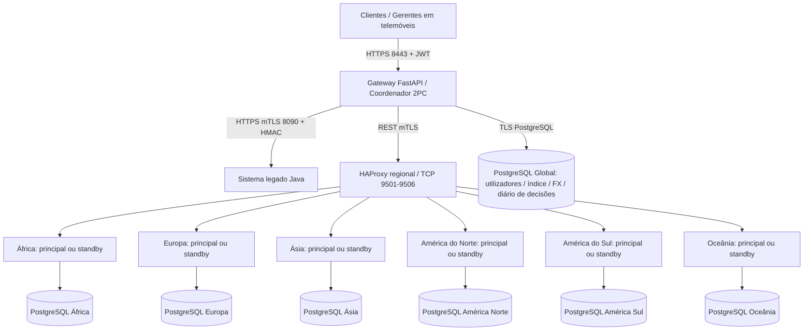

# Arquitectura do NandBank (Exame SDP)

## Topologia



As aplicações principal e standby compartilham o mesmo PostgreSQL **regional**, não replicado. A fragmentação é por continente: os registos locais de saldo e movimentos ficam exclusivamente no nó de cada continente; o banco global mantém apenas identidade, directório de contas (sem saldo), taxas e decisões 2PC.

### Portas

| Serviço | Porta na rede Docker | Acesso no Windows |
|---|---:|---|
| Gateway HTTPS | 8443 | TCP 8443 (única publicada) |
| Legado Java TLS | 8090 | Não exposta |
| HAProxy seis endpoints | 9501–9506 | Não exposta |
| Apps regionais TLS | 9443 | Não expostas |
| PostgreSQL global e regional | 5432 | Não expostas |
| NFS opcional | Interna | Apenas perfil DFS |

## Fluxo de uma transferência entre dois continentes

```mermaid
sequenceDiagram
  participant C as Cliente
  participant G as Gateway/Coordenador
  participant D as Diario global PostgreSQL
  participant A as Europa
  participant B as Asia
  C->>G: POST transfer + JWT + idempotency_key
  G->>D: criar NEW (transaccao única)
  G->>G: câmbio/commissionamento + validação Java
  G->>D: PREPARING
  G->>A: PREPARE débito
  A->>A: BEGIN; FOR UPDATE; debitar; PREPARE TRANSACTION
  A-->>G: PREPARED
  G->>B: PREPARE crédito
  B->>B: BEGIN; creditar; PREPARE TRANSACTION
  B-->>G: PREPARED
  G->>D: gravar DECISION_COMMIT duravelmente
  G->>A: COMMIT PREPARED
  G->>B: COMMIT PREPARED
  G->>D: COMMITTED
  G-->>C: confirmação e comprovativo PDF
```

Em caso de erro durante o PREPARE, o coordenador grava DECISION_ABORT antes de emitir ROLLBACK PREPARED; faltando uma das confirmações, mantém o estado pendente até ser possível reconciliar.

### Falha de filial durante a operação

- Se `as-primary` ficar indisponível: HAProxy detecta porta sem resposta e escolhe `as-standby`.
- A chamada é repetida com o mesmo identificador, pelo que não são criados dois débitos.
- Um `PREPARE TRANSACTION` permanece no PostgreSQL mesmo depois de terminar a ligação do serviço; a standby recupera pelo mesmo identificador da transacção.
- Se a decisão COMMIT já estiver registada globalmente, o reconciliador nunca muda para ABORT: tenta concluir os commits em falta.
- Se o **PostgreSQL regional** ficar indisponível, a aplicação não promete aceitar novas escritas. É necessária uma solução adicional de réplica/promoção de BD para esse tipo de falha.

## Segurança

- Certificados emitidos por CA local própria por instalação, RSA com SAN de serviços.
- HTTPS na porta 8443, e no Java legado 8090.
- Certificado de cliente obrigatório em cada aplicação regional e no Java legado (mTLS).
- TLS com verificação de nome do host entre todos os PostgreSQL e as aplicações.
- Tokens JWT RS256 emitidos no Gateway e verificados independentemente nos nós regionais pela chave pública.
- HMAC-SHA256 nos pedidos de integração Java, calculado sobre os bytes exactos da mensagem JSON.
- Passwords derivadas por PBKDF2-HMAC-SHA256 (310 000 iterações e salt por utilizador).
- Dados fictícios; sem exposição pública das bases de dados.

## Regras bancárias e moedas

As seis moedas têm duas casas decimais e saldos inteiros em centésimos. Câmbio via `Decimal`, arredondamento `ROUND_HALF_UP` para centésimos. Cotação por uma base EUR, com fotografia `rate_text` gravada no diário 2PC. Comissão de demonstração de 1% acrescentada ao valor a transferir; depósito do balcão sem comissão. As cotações iniciais são **fictícias**. Na mesma região, transferência entre duas contas executa-se na mesma transacção ACID com linhas bloqueadas na ordem de ID.

## Exclusões deliberadas e melhorias

- Não implementa pagamentos reais, cartões bancários reais, KYC, supervisão bancária ou contabilização regulamentar.
- Não oferece failover físico de computadores nem eleição de PostgreSQL secundário em todos os continentes.
- NFS só pode ser marcado concluído após demonstração no teu WSL2; consultar `docs/DFS.md`.
- Não realiza benchmarks CORBA/REST nesta fase. O novo enunciado pede apenas uma análise OMA/CORBA; o benchmark do Laboratório 6 é conteúdo complementar.
